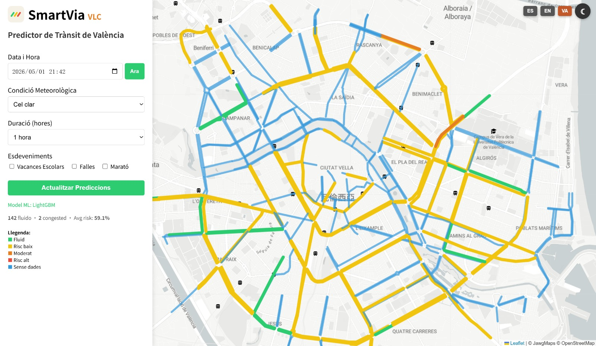

<p align="center">
  
</p>

<p align="center">
  <strong>1-hour-ahead traffic congestion prediction for 144 road segments in Valencia, Spain</strong><br>
  LightGBM &middot; Flask &middot; Leaflet.js &middot; AWS
</p>

<p align="center">
  
  
  
  
  
</p>

> **Status:** the public website (smartviavlc.com) has been taken offline because of hosting costs. You can still run the web app locally, see [Run the web app locally](#run-the-web-app-locally).

<p align="center">
  
</p>

## Overview

SmartVia VLC (project name **METEO-TRAFFIC**) predicts whether each of Valencia's 144 monitored road segments will be congested one hour ahead. It was built by a team of six for **Proyecto III** of the **Grado en Ciencia de Datos** at the Universitat Politècnica de València (UPV).

The project set out to test whether weather, together with time and local events, helps forecast congestion. The main finding is that **weather adds no predictive signal**: almost all of it comes from each road's own recent traffic history.

## Key results

- **Final model:** LightGBM using only temporal and lag features plus the road-segment ID (22 features) reaches **Macro F1 = 0.8256** on the held-out 2025 test set (1,265,734 observations).
- **Weather alone is no better than random** (Macro F1 = 0.50). All five weather variables have an absolute correlation below 0.01 with congestion.
- **One feature does most of the work.** The road's traffic state one hour earlier (`estado_lag_4`) reaches Macro F1 = 0.78 on its own, almost the same as the original 39-feature model (0.79).
- `time_since_last_congestion` accounts for **44% of the final model's total gain**.
- The gradient-boosting models compared (HistGradientBoosting, XGBoost, CatBoost, LightGBM) all landed around Macro F1 = 0.80 with the original features, and HistGradientBoosting reproduces the ablation results within about 0.02. The ceiling comes from the data, not the algorithm.

### Feature ablation

Seven LightGBM models with identical hyperparameters, identical SMOTE-balanced training data and the same threshold optimization. Only the feature set changes. Evaluated on the 2025 test set; "congested" is the `no_fluido` class.

| Configuration | Threshold | Precision (congested) | Recall (congested) | F1 (congested) | Macro F1 |
|---|---|---|---|---|---|
| Weather only | 0.60 | 0.0194 | 0.0184 | 0.0189 | 0.5012 |
| All original features except `estado_lag_4` | 0.44 | 0.2015 | 0.1695 | 0.1841 | 0.5861 |
| `estado_lag_4` only | 0.38 | 0.5722 | 0.5717 | 0.5719 | 0.7823 |
| All original features (39) | 0.69 | 0.6300 | 0.5463 | 0.5852 | 0.7893 |
| All original features except weather | 0.68 | 0.6001 | 0.5350 | 0.5657 | 0.7812 |
| All features + new temporal & lag features | 0.83 | 0.8167 | 0.5354 | 0.6468 | 0.8214 |
| **Temporal & lag features + road ID (final)** | **0.87** | **0.7427** | **0.5869** | **0.6557** | **0.8256** |

The richest model scores slightly below the final one: under SMOTE-balanced training, the weakly informative weather, event and season features add more noise than signal.

## Data

| Source | Content |
|---|---|
| Valencia City Council open data | Traffic state of each road segment every 15 minutes, December 2022 to September 2025 |
| AEMET | Daily weather: mean, minimum and maximum temperature, precipitation, sunshine hours |
| Events calendar (built by the team) | Public and school holidays, Fallas and mascletàs, Valencia CF and Levante UD home matches, concerts, marathons, elections, demonstrations, EBAU exams, San Juan and more |

Preparation:

- The merged dataset has about **5.4 million observations** (2023–2025) across 144 road segments.
- Hours from 01:00 to 06:00 were removed because traffic is consistently fluid then. Peak hours keep 15-minute intervals; off-peak hours were aggregated to 30-minute intervals.
- The target is binary: `no_fluido` (congested) vs `fluido`. Only about 1% of observations are congested.
- Temporal split: train on 2023–2024, test on 2025.
- The one apparent outlier, the maximum temperature on 10 August 2023, is real (one of the hottest days in recent years), so it was kept.

## Method

The project follows **CRISP-DM**. Features fall into five groups:

- **Temporal:** minute of day; sine/cosine encodings of time of day, month and day of month; week of year; weekend, rush-hour and night flags.
- **Categorical:** road segment and day of week (label-encoded).
- **Weather:** `tmed`, `tmin`, `tmax`, `prec`, `sol` (standardized).
- **Seasonal and event flags:** 4 season flags and 14 event flags.
- **Lag features:** the same road's traffic state one hour earlier (`estado_lag_4`), plus six history features: rolling means over 1–2 h, 1–3 h and 2–3 h before, the trend between them, the length of the current congestion streak and the time since the last congestion. All are anchored at least one hour back, so nothing leaks into a 1-hour-ahead prediction.

Training and evaluation:

- **Class balance:** the training set is SMOTE-balanced to 200K majority + 200K synthetic minority samples.
- **Threshold:** the decision threshold is tuned for Macro F1. Because SMOTE trains on a 50/50 split while real traffic is about 99/1, the best threshold sits far above 0.5.
- **Calibration (Brier score, lower is better):** LightGBM 0.0201, HistGradientBoosting 0.0209, CatBoost 0.0255, GradientBoosting 0.0423, XGBoost 0.0643. LightGBM was chosen as the primary model.

## Final model

| Group | Features |
|---|---|
| Lag | `estado_lag_4`, `estado_rolling_4_to_8`, `estado_rolling_4_to_12`, `estado_rolling_8_to_12`, `estado_trend`, `consecutive_congested_steps`, `time_since_last_congestion` |
| Time | `minutes`, `hour_sin`, `hour_cos`, `month`, `month_sin`, `month_cos`, `day`, `day_sin`, `day_cos`, `week_of_year` |
| Flags | `is_weekend`, `is_rush_hour`, `is_night` |
| Calendar | `Day_of_week` (label-encoded) |
| Road | `Denominació / Denominación` (road segment, label-encoded) |

| Hyperparameter | Value |
|---|---|
| `num_leaves` | 63 |
| `learning_rate` | 0.05 |
| `max_depth` | -1 |
| `min_child_samples` | 50 |
| `subsample` | 0.8 |
| `colsample_bytree` | 0.8 |
| `reg_alpha` / `reg_lambda` | 0.1 / 0.1 |
| `num_boost_round` | 500 |

Results on the 2025 test set (1,265,734 observations, threshold 0.87):

| Metric | Value |
|---|---|
| Macro F1 | 0.8256 |
| Precision (congested) | 0.7427 |
| Recall (congested) | 0.5869 |
| F1 (congested) | 0.6557 |
| Precision (fluid) | 0.99 |
| Recall (fluid) | 1.00 |

## Web app

- Interactive Leaflet.js map with color-coded congestion risk for each road segment
- Pick a date, time, duration, weather preset (clear, cloudy, rainy) and events (school holidays, Fallas, marathon)
- English, Spanish, Valencian and Chinese
- Light and dark map themes
- Works on desktop and mobile

> **Note:** the web app in this repository (`app3.py`) still serves an earlier model, `lightgbm_lag_v2_model.txt`. It uses 44 features, including weather, event flags and 15-minute lags (`estado_lag_1`, `estado_lag_2`), and predicts in 15-minute steps. With no live traffic feed, its lag features are seeded with historical average congestion per road, day of week and time slot. The final 1-hour-ahead model above lives in `model2.ipynb` and has not been exported to the app yet.

### Deployment on AWS

```
Browser
   │
   ▼
Route 53 (DNS)
   │
   ▼
EC2 instance (Ubuntu 22.04)
   │
   ▼
Nginx (port 80/443) ──► Gunicorn ──► Flask API (app3.py)
                                        │
                                LightGBM model (.txt)
                                Preprocessors (.joblib)
```

- Gunicorn serves the Flask API as a production WSGI server.
- Nginx is the reverse proxy, with HTTPS from Let's Encrypt (Certbot).
- A systemd service keeps the app running and restarts it after a reboot.
- Route 53 A records point the domain at the EC2 instance's public IP.

### Run the web app locally

```bash
git clone https://github.com/jiale203/SmartVia-VLC---Valencia-Traffic-Predictor.git
cd SmartVia-VLC---Valencia-Traffic-Predictor
pip install flask flask-cors pandas numpy lightgbm joblib scikit-learn
python app3.py
```

Then open `http://localhost:5002`.

## Reproduce the analysis

1. Unzip `dataset_final.zip` to get `dataset_final.csv` (about 730 MB).
2. Install the dependencies: `pandas numpy scipy scikit-learn imbalanced-learn lightgbm xgboost catboost matplotlib seaborn`.
3. Open `model2.ipynb`. It was written for Google Colab, so change the `read_csv` path to your copy of `dataset_final.csv`.

## Repository structure

| File | Purpose |
|---|---|
| `model2.ipynb` | Final analysis from the report: EDA, model comparison, calibration, feature ablation and final model |
| `PROYECTOIII_TRAFICO_FINAL.ipynb` | Traffic data preparation: unpacks, counts and merges the daily traffic files |
| `PROYECTOIII_TRAFICO2_Bueno.ipynb` | Aggregates the filtered traffic data (produces `Agregacion2.csv`) |
| `c.py` | Joins the merged traffic and weather data with the events calendar |
| `climatologia_2023_2025.csv` | AEMET weather data |
| `DatasetFestivos.csv` | Holidays and events calendar |
| `dataset_final.zip` | Final merged dataset |
| `train_lightgbm_lag_v2.py` | Trains the earlier v2 model used by the web app |
| `save_preprocessors_lag.py` | Builds the encoders, scaler and historical lag tables the app loads |
| `lightgbm_lag_v2_model.txt` | Trained v2 model used by the web app |
| `*.joblib` | Encoders, scaler, list of known roads and historical congestion tables |
| `app3.py` | Flask API |
| `website3.html`, `datos_trafico.js` | Front end (Leaflet map) and road-segment coordinates |
| `smartvia.png`, `smartvia-logo-light.svg`, `p1.jpeg` | Logo and screenshot |

## Limitations

- **Probabilities are not calibrated.** The tuned threshold fixes decisions, but showing users a "70% chance of congestion" would need post-hoc calibration such as isotonic regression or Platt scaling.
- **No live traffic data.** The app approximates lag features with historical averages, so its predictions cannot react to what is happening on the road right now.
- **Night gap.** Data from 01:00 to 06:00 was removed. In training, early-morning lag features jump back to the previous night; in the app, the historical lookup for those hours finds no data.
- **Manual inputs.** Weather is chosen from presets and events must be selected by the user.

## Future work

- Connect a live traffic feed from the city council to replace the historical lag seeds.
- Export the final 1-hour-ahead model into the web app.
- Try sequential architectures to see whether more temporal context improves robustness.
- Add route recommendations that avoid congested segments.

## Team

Miguel Ángel Camuñas Castelló, Lucía Fuentes Pons, Vicente Llacer Llorca, Ivette Mahmoud Yousef Puig, Jiale Mao, María Martínez Fernández

Team repository: [Llacerino/PROYECTOIII-SMARTVIAVLC](https://github.com/Llacerino/PROYECTOIII-SMARTVIAVLC)

## References

- Cools, M., Moons, E., & Wets, G. (2010). Assessing the Impact of Weather on Traffic Intensity. *Weather, Climate, and Society*, 2(1), 60–68.
- Abduljabbar, R., Dia, H., & Liyanage, S. (2024). Machine Learning Models for Traffic Prediction on Arterial Roads Using Traffic Features and Weather Information. *Applied Sciences*, 14(23), 11047.
- Li, Y., Yu, R., Shahabi, C., & Liu, Y. (2017). Diffusion Convolutional Recurrent Neural Network: Data-Driven Traffic Forecasting. arXiv:1707.01926.

## License

This project is licensed under the GNU General Public License v3.0. See the [LICENSE](LICENSE) file for details.
